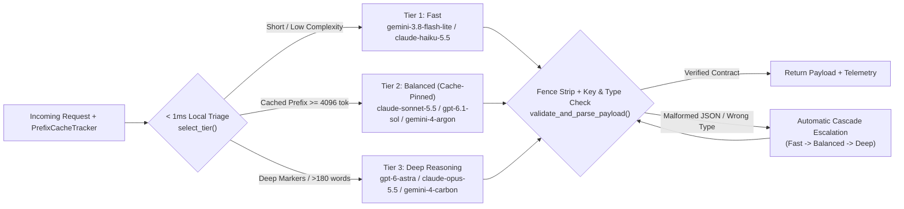

# Production 3-Tier AI Model Router (Zero Frameworks)

A zero-dependency, pure Python 3-tier AI model router engineered for production B2B workloads. It replaces viral "10-line LLM-judge classifiers" with **sub-millisecond (`0.02 ms`) local triage**, **Prompt Cache prefix pinning (`90%–95%` cached input discount preservation)**, **SHA-256 Prefix Cache TTL tracking**, and **Typed Schema Cascade Fallback** (sync + `async`) so cheap tiers never silently crash downstream webhooks.

> **Note:** API pricing shown in this repository reflects verified provider rates as of **November 16, 2026**, and may change over time.

---

## 1. Quick Start — Run Every Demo & Simulator (Zero Dependencies)

Requires **Python 3.10+** (tested on Python 3.14). Zero external packages required.

```bash
# 1. Reproduce Clip 1: Audit why the viral "10-line LLM Judge" router fails in production
python naive_router_fail.py

# 2. Reproduce Clip 3: Live 4-workload telemetry + automatic Schema Cascade rescue
python run_router_benchmark.py

# 3. Run the interactive Cost & Break-Even Simulator with your own traffic numbers
python cost_simulator.py --requests 1000000 --cached-tokens 24000 --fail-rate 0.06

# 4. Run the full 10-test unit suite (sync, async, TTL cache tracker, typed schemas, 2026 payloads)
python test_router.py
```

---

## 2. Why the Viral "10-Line LLM Judge" Router Fails in Production

Many tutorials recommend calling a cheap model (`max_tokens=1, temperature=0`) to classify every incoming prompt as `"EASY"` or `"HARD"` before calling your main model. In real production systems, that pattern fails for four concrete engineering reasons:

1. **The Classifier Latency Tax (`+150–500 ms` TTFT):** Making an extra network roundtrip just to pick a model doubles your Time-To-First-Token on simple queries. Local deterministic triage in `select_tier()` takes **`0.02 ms`**.
2. **2026 Reasoning API Parameter Rejections (`HTTP 400`):** Modern reasoning endpoints reject legacy `temperature=0` and `max_tokens=1` parameters—requiring `max_completion_tokens` and native `reasoning.effort` / `effort` / `thinkingLevel` controls (where `1` completion token starves hidden reasoning tokens before a single visible character is emitted).
3. **Prompt Cache Destruction (`90%–95%` Discount Lost):** Splitting a multi-turn conversation or RAG workflow with a warm `16k–64k` token prefix across uncoordinated model endpoints invalidates your cached prefix.
4. **Silent `200 OK` Schema Crashes:** Ultra-light models (`Flash-Lite` / `Haiku` / `Luna`) are ~20x–50x cheaper, but under strict tool schemas or JSON contracts they occasionally truncate JSON or emit wrong field types while still returning `HTTP 200 OK`. Without an in-memory validation cascade, your downstream billing or webhook worker crashes.

---

## 3. Deep Dive: The Mathematical Proofs (What Couldn't Fit in the 2-Minute Video)

### 3.1 Proof 1 — Why a `$2.00` Balanced Model Is Cheaper Than a `$0.25` Fast Model on Warm Contexts

Suppose your RAG or coding assistant attaches a warm **`24,000`-token** system/context prefix:
- **If you route cold to the Fast tier (`$0.25 / 1M` uncached input):**
  $$\text{Input Cost}_{\text{fast, cold}} = 24{,}000 \times \frac{\$0.25}{10^6} = \$0.00600\text{ per request}$$
- **If you keep the prefix pinned to the Balanced tier (`$0.10 / 1M` cached input, `95%` discount off `$2.00`):**
  $$\text{Input Cost}_{\text{balanced, cached}} = 24{,}000 \times \frac{\$0.10}{10^6} = \$0.00240\text{ per request}$$
- **If a naive router causes a cache miss on the Balanced tier (`$2.00 / 1M` uncached input):**
  $$\text{Input Cost}_{\text{balanced, miss}} = 24{,}000 \times \frac{\$2.00}{10^6} = \$0.04800\text{ per request (20}\times\text{ more expensive!)}$$

By pinning warm prefixes (`cached_tokens >= 4096`) via `select_tier()` and tracking active prefix TTLs with `PrefixCacheTracker`, you prevent cross-tier cache thrashing automatically.

### 3.2 Proof 2 — Cascade Escalation Break-Even Rate ($p_{\text{escalate}}$)

When routing strict JSON workloads (`W3_STRICT_WEBHOOK`) to the Fast tier first (`Cost_fast`) and cascading to Balanced (`Cost_balanced`) only when `validate_and_parse_payload()` catches a `JSONDecodeError`, `ValueError`, or `TypeError`:

$$\mathbb{E}[\text{Cost}] = \text{Cost}_{\text{fast}} + p_{\text{escalate}} \cdot \text{Cost}_{\text{balanced}}$$

Since $\text{Cost}_{\text{fast}} \approx 0.14 \times \text{Cost}_{\text{balanced}}$, cascading saves money for any fast-tier failure rate up to **$p_{\text{escalate}} < 86\%$**—and at typical production truncation rates ($p_{\text{escalate}} \approx 4\%–8\%$), it delivers **fast-tier pricing on `92%+` of traffic with `0.0%` broken webhooks**.

---

## 4. Production 3-Tier Architecture



---

## 5. Verified 3-Tier API Pricing Matrix & 2026 Reasoning Controls (As of November 16, 2026)

Rates are listed per **1M tokens** (Uncached Input / Cached Input / Output, including hidden reasoning tokens):

| Routing Tier | Representative Models (Nov 2026) | Uncached Input / 1M | Cached Input / 1M | Output / 1M | Native Effort Parameter |
| :--- | :--- | :--- | :--- | :--- | :--- |
| **Tier 1 — Fast (`low`)** | `gemini-3.8-flash-lite`, `claude-haiku-5.5`, `gpt-5.6-luna` | `$0.10 – $0.25` | `$0.020 – $0.025` | `$0.50 – $1.50` | `thinkingLevel="LOW"` / `effort="low"` |
| **Tier 2 — Balanced (`medium`)** | `claude-sonnet-5.5`, `gpt-6.1-sol`, `gemini-4-argon` | `$2.00` | `$0.10` *(95% off)* | `$10.00` | `effort="medium"` / `reasoning.effort="medium"` |
| **Tier 3 — Deep (`high`)** | `gpt-6-astra`, `claude-opus-5.5`, `gemini-4-carbon` | `$4.00 – $10.00` | `$0.20 – $1.00` | `$20.00 – $50.00` | `reasoning.effort="high"` / `thinkingLevel="HIGH"` |

*(Note: Google Gemini 4 Carbon and Gemini 4 Argon reflect promotional rates of `$2.00 / $10.00` through November 30, 2026, transitioning to standard `$4.00 / $20.00` on December 1, 2026).*

---

## 6. Drop-In Code Examples (Sync, Typed Contracts, Prefix Tracker & FastAPI Async)

### 6.1 Sync Routing with Typed Schema Validation & Prefix Cache Tracking

```python
from router import PrefixCacheTracker, route_with_cascade

cache_tracker = PrefixCacheTracker(ttl_seconds=300.0)
system_rag_prefix = "..."  # Your static >= 4,096-token system prompt or RAG context

# Automatically check if prefix is warm in cache (0 network calls)
warm_tokens = cache_tracker.get_warm_tokens(system_rag_prefix)

result = route_with_cascade(
    prompt="Extract billing webhook payload.",
    invoker=my_llm_client,
    # Enforces both required keys AND exact Python types (strips ```json fences automatically)
    required_keys={"invoice_id": str, "status": str, "total_usd": (int, float)},
    cached_tokens=warm_tokens,
)

# Record prefix warmth for subsequent requests
cache_tracker.record_prefix(system_rag_prefix, tier=result["tier"])
print(result["tier"], result["model"], result["triage_ms"], result["data"])
```

### 6.2 Async FastAPI Integration (`route_with_cascade_async`)

```python
from router import route_with_cascade_async

async def handle_webhook(prompt: str) -> dict:
    return await route_with_cascade_async(
        prompt=prompt,
        async_invoker=my_async_llm_client,
        required_keys={"invoice_id": str, "status": str},
        cached_tokens=0,
    )
```

---

## 7. Repository Structure

| File | Purpose |
| :--- | :--- |
| `router.py` | Core 3-tier router (`select_tier`, `route_with_cascade`, `route_with_cascade_async`, `PrefixCacheTracker`, `validate_and_parse_payload`). |
| `naive_router_fail.py` | Reproduces the 4 production failures of the viral "10-line LLM classifier" router (`Clip 01`). |
| `run_router_benchmark.py` | Live 4-workload telemetry trace + Schema Cascade rescue & monthly invoice audit (`Clip 03`). |
| `cost_simulator.py` | Interactive CLI simulator to model your own startup's monthly traffic, RAG prefix size, and break-even thresholds. |
| `providers.py` | 2026 payload builders & zero-dependency HTTPS invokers for OpenAI, Anthropic, and Google Gemini. |
| `benchmark.py` | Compact tabular CLI benchmark comparing Flagship-Only vs 3-Tier Cache-Pinned routing. |
| `test_router.py` | 10-test `unittest` / `pytest` suite covering sync/async cascade, TTL cache tracking, fence stripping, and type contracts. |

---

## License

MIT License. Free for commercial and private use.
